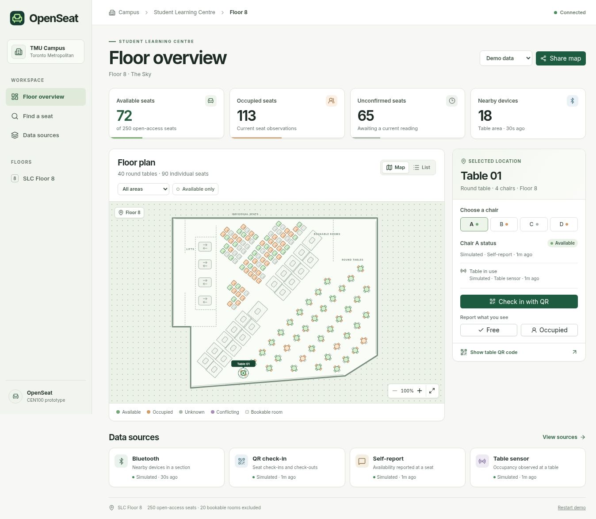
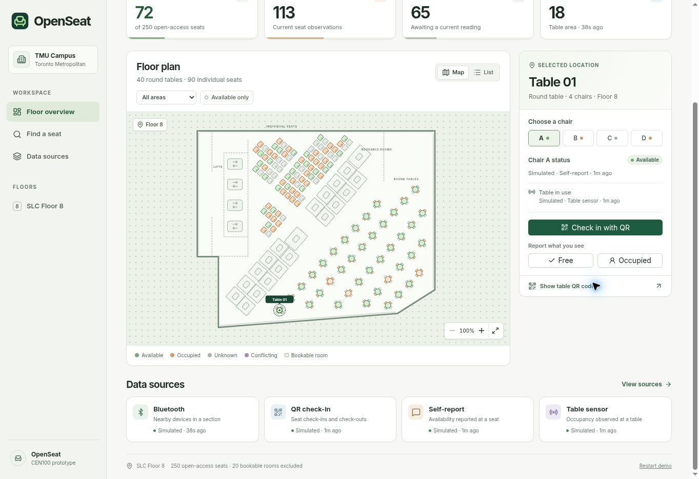

# OpenSeat · CEN100 prototype record

The CEN100 Milestone 5 prototype: what was built, how, and how it was tested.

## Concept and scope

A student should be able to find a free study seat before walking over. The midterm decision matrix chose a map that students update themselves. This version keeps that map and adds three more inputs: QR check-in for a specific chair, a Bluetooth device count for each area, and table sensors for when nobody reports. Every reading shows its source and age, so old information is easy to spot. The prototype covers one floor, and one person can demo it on an iPhone and an iPad.

## Build plan and materials

| Step | Goal and materials | Date and evidence |
| --- | --- | --- |
| 1. Set the scope | Trace the floor drawing: 40 four-chair tables, 92 individual seats and 20 bookable rooms. | Nov 17 · traced layout below |
| 2. Set the Bluetooth rule | Use the BLE2MQTT calibration readings to count devices at −75 dBm or stronger. | Nov 17 · calibration below |
| 3. Build the map | Place the furniture, give each seat an ID, make seats searchable, and add timestamps, conflict rules and expiry. | Nov 17 · dashboard below |
| 4. Connect the four inputs | Shared storage, QR check-in and check-out, one-tap free or taken reports, a sensor receiver and Bluetooth scan counting. | Nov 17 · table QR below |
| 5. Test the student journey | Test the app, shared service, QR code and seat rules. Keep automated results separate from tests with people or hardware. | Nov 17 · results below |

The phone, iPad, floor drawing and Bluetooth scans were already on hand, so extra hardware cost $0. Simulated readings stood in for table hardware. GitHub Pages hosts the site, and a hosted database shares readings between browsers.

## Process evidence

**Stage 1.** The floor plan on its own, with every chair marked Unknown. The 40 four-chair tables and 92 individual seats match the drawing, for 252 open seats. The seat and table IDs were made up for the prototype.

**Stage 2.** The full demo: floor totals, the area device count, selectable tables and chairs, and where and when each reading came from. The demo and the live floor keep separate data, and every example reading is marked simulated.

**Stage 3.** Each table's QR code opens check-in for that table, so one tester can check in to a chair from a second device. The code and shared data were tried with test sessions.

## Calibration already completed

| Reading for the same reference device | Received power | Included at −75 dBm |
| --- | ---: | --- |
| First | −80 dBm | No |
| Second | −82 dBm | No |
| Third | −80 dBm | No |
| Fourth | −73 dBm | Yes |
| Fifth | −72 dBm | Yes |

These readings are enough for a working threshold. They were taken in the library, so they say nothing about how many people are on SLC Floor 8, where they sit, or how accurate the count is there. Several people can share a table, and one person can carry several devices.

## Verification

The site now runs on Firebase Realtime Database (free Spark plan). The move kept all 38 readings and their times across 10 demo sessions. On every release, an automatic check opens the live site in desktop Chromium and mobile WebKit, follows a table QR code, checks that both browsers see the same chair updates, and opens this page, using a new demo session each time. [Release checks and browser screenshots](https://github.com/jude27mad/OpenSeat/actions/workflows/pages.yml)

| Criterion | Result | Evidence |
| --- | --- | --- |
| All 252 open seats counted and the 20 bookable rooms left out | Pass | Automated checks. With no data, all 252 seats show unknown. |
| −75 dBm threshold, each device counted once per scan, old scans ignored | Pass | Automated tests with −76, −75 and stronger readings, repeated device IDs and expired scans. |
| All four inputs saved in one session | Pass | The original Floot API returned QR, report, sensor and Bluetooth readings together. It refused another browser’s check-out (HTTP 409) and accepted the original browser’s. The Firebase rules tests also check who can check out. |
| A check-in shows on a second screen within 10 seconds | Pass | On the original Floot version of the live site, the second browser showed Occupied 1.38 seconds after check-in. A free report showed Conflicting, and after check-out the chair showed Available. The two browsers had separate storage. |
| A phone can use a table QR code and read the map without scrolling sideways | Pass | On the original Floot version, GitHub Actions read the QR image, checked in on mobile WebKit and saw the update in desktop Chromium 1.46 seconds later. The phone page fit the screen. [Browser test run](https://github.com/jude27mad/OpenSeat/actions/runs/44208568779) |
| Area counts and table sensors don’t create fake seat counts | Pass | An area count of 128 and an occupied table sensor left all 252 chairs unknown without chair reports. A free chair stayed free at a table in use. |
| A sensor that disagrees with the chairs shows Mixed reports, and old readings turn into unknown | Pass | Automated tests check the disagreement and that an old report keeps its source and age. |
| A student can find a real open seat within 10 seconds before walking over | Not measured | Needs a timed test with a person and a check of the seat on site. |
| Installed table hardware and count accuracy across campus | Not measured | The receiver was built and tried with simulated readings. There was no installed sensor or real occupancy count to compare against. |

## Attribution

**Student design work:** combining the four inputs, choosing Floor 8 and the dashboard reference, the furniture inventory and map, and the Bluetooth calibration and cutoff.

**AI-assisted development:** the React prototype, shared service, QR codes, simulator and tests, built from those decisions, plus this record and its screenshots.
