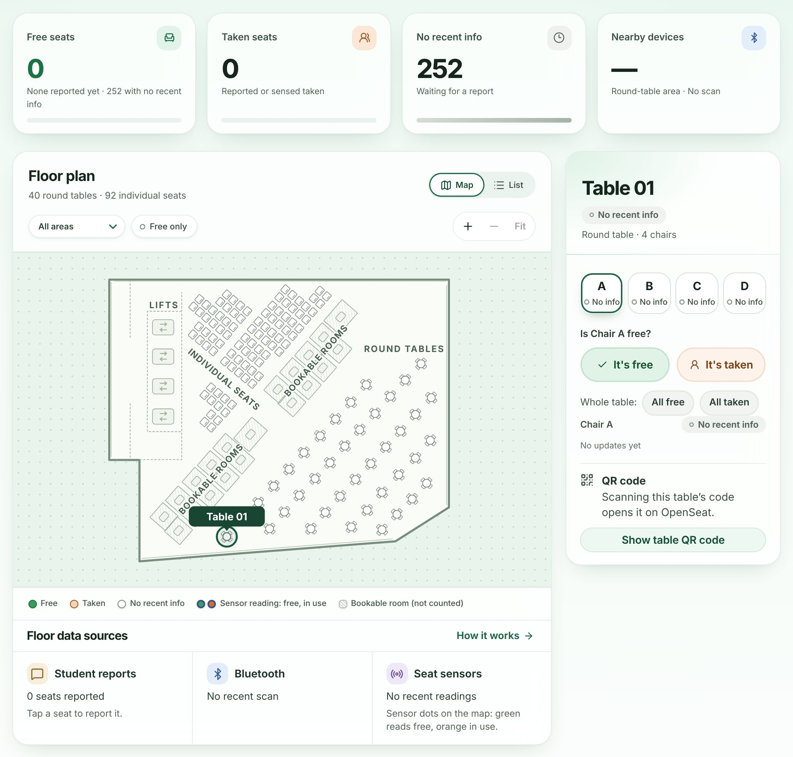
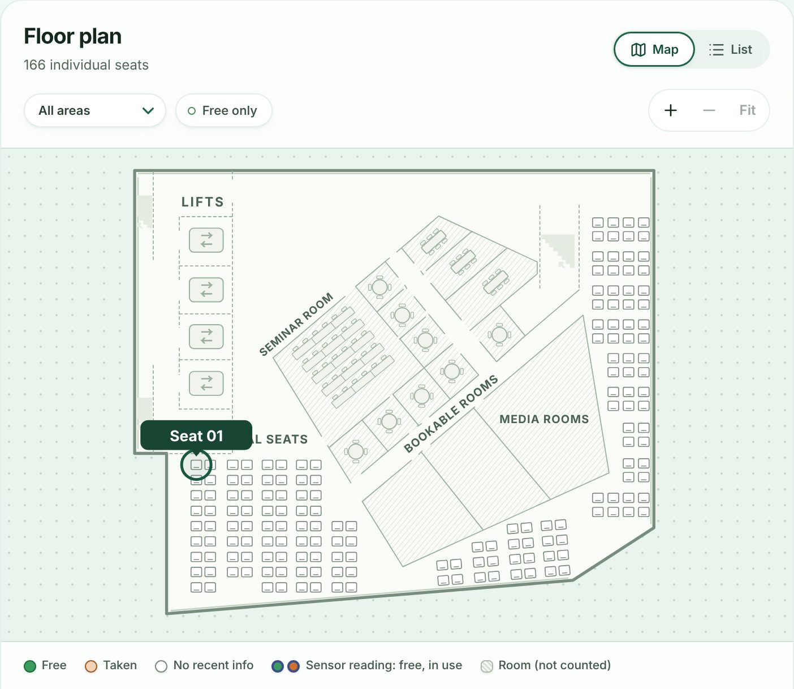
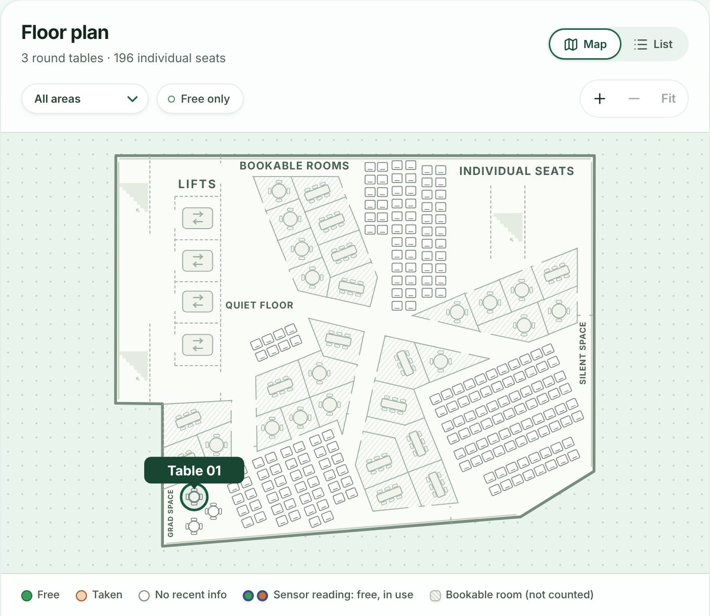
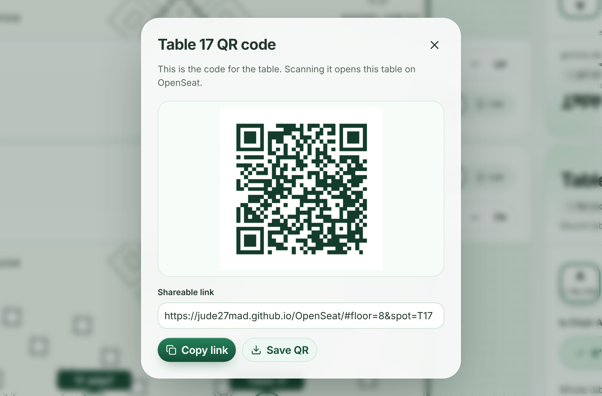

# OpenSeat · CEN100 prototype record

Milestone 5 prototype: how it was built and tested.

## Concept and scope

Find a free study seat before walking over. One map, three sources: student reports, seat sensors and Bluetooth counts. Each seat shows where its status came from and how old it is. Bluetooth counts devices in an area, so it never marks a single seat. Each table and seat also has a QR code that opens it on the site, ready to report. Scope: SLC Floors 5, 7 and 8, demoed on an iPhone and an iPad.

## Build plan and materials

| Step | Goal and materials | Date and evidence |
| --- | --- | --- |
| 1. Establish scope | Count only the open seats. Rooms are drawn on the map but not counted. Floor 8: 40 round tables with 4 chairs and 92 individual seats = 252. 20 bookable rooms not counted. Floor 7: 196 individual seats and 3 four-chair tables in the grad space = 208. 30 bookable rooms not counted. Floor 5: 166 individual seats. 11 bookable rooms, a seminar room and 3 media rooms not counted. Total: 626 seats. | Nov 17 to 19 · Stages 1 and 2 |
| 2. Set the Bluetooth rule | Use the BLE2MQTT calibration readings we already had to set an inclusive −75 dBm cutoff. Each device counts once per scan. | Nov 17 · calibration below |
| 3. Build the Floor 8 map | Trace the supplied drawing, number every table and seat, and make seats searchable. The first trace had 90 individual seats. We found 2 more and mapped all 92 on Nov 18. | Nov 17 to 18 · Stage 1 |
| 4. Connect the inputs and test | Connect the first four inputs: student reports, QR check-in, a table-sensor receiver and Bluetooth counts, shared between devices. Write the first automated tests. On Nov 18, move the shared data to Firebase and add a daily job that deletes unused demo rooms. | Nov 17 to 18 · verification below |
| 5. Add Floors 5 and 7 | Trace both floors from the library's booking maps and draw them in the same style as Floor 8. | Nov 19 · Stage 2 |
| 6. Switch to seat sensors | Replace table sensors with a sensor on each seat. A current seat-sensor reading decides the seat. The demo gets sensor buttons, but Bluetooth is never simulated. | Nov 20 to 21 · Stage 3 |
| 7. Add the classroom count | A page that turns one Bluetooth scan into a range of people (1 to 2.2 devices per person), for the classroom demo. | Nov 21 · Stage 5 |
| 8. Simplify QR codes | Remove QR check-in. Each QR code now just opens its table or seat on the site, ready to report. | Nov 22 · Stage 4 |

### Materials and cost

| Item | What it was used for | Cost |
| --- | --- | --- |
| iPhone with the BLE2MQTT app | Bluetooth scanner, and testing the site on a phone | $0, already had |
| iPad | Testing the site on a tablet | $0, already had |
| Floor maps | The supplied Floor 8 drawing and the library's booking maps for Floors 5 and 7, used to trace the seats | $0 |
| flespi | Relays each Bluetooth scan from the iPhone to the site | $0 |
| Firebase Realtime Database | Shares reports, sensor readings and Bluetooth counts between devices (free plan) | $0 |
| GitHub Pages | Hosts the site | $0 |
| Seat sensors | None bought or installed yet. The demo simulates sensor readings with buttons | $0 |
| Total extra cost | Nothing was bought for this build | $0 |

## Process evidence

Screenshots of the current build, taken on Nov 22.

**Stage 1.** Floor 8 before any data comes in. All 252 seats show **No recent info**. The 20 bookable rooms are drawn but not counted.

**Stage 2.** Floors 5 and 7, traced from the library's booking maps and drawn in the Floor 8 style. Floor 5 has 166 individual seats. Floor 7 has 196 individual seats and 3 round tables in the grad space.

**Stage 3.** The demo with example data, right after pressing **Find me a free seat**. It opened Table 31, with 2 of 4 chairs free. The panel shows Chair A's status, source and age, its sensor line with the demo sensor buttons, and the report buttons.

**Stage 4.** The QR code for Table 17 on Floor 8. Scanning it opens that table on the site, ready to report.

**Stage 5.** The classroom page turns one Bluetooth count into a range of people. This screenshot uses a test reading of 30 devices, not a real scan, so it shows 14 to 30 people.

## Calibration already completed

| Reading (same device) | Power | Counted at −75 dBm |
| --- | ---: | --- |
| First | −80 dBm | No |
| Second | −82 dBm | No |
| Third | −80 dBm | No |
| Fourth | −73 dBm | Yes |
| Fifth | −72 dBm | Yes |

Taken in the library. It sets the threshold but doesn't measure people on any floor.

## Verification

Every release is tested automatically in desktop and phone browsers. [Release checks](https://github.com/jude27mad/OpenSeat/actions/workflows/pages.yml)

| Test | Result | Evidence |
| --- | --- | --- |
| 626 seats counted on Floors 5, 7 and 8, rooms left out | Pass | Automated check (252 + 208 + 166) |
| −75 dBm cutoff, each device counted once | Pass | Automated tests |
| Reports, sensor readings and Bluetooth counts saved to the shared database | Pass | Database rule tests |
| A report shows on a second screen within 10 s | Pass | Automated two-device test. It fails if the report takes over 10 s |
| A phone can scan a QR code and open that table or seat | Pass | Automated tests |
| Area counts don't fake seat counts | Pass | 128 devices left all seats unknown |
| A current seat sensor decides the seat, and old readings expire | Pass | Automated tests |
| A student finds a seat within 10 s | Pass | Automated test on the demo, on a desktop and a phone: open the site and press **Find me a free seat**. A free seat opens in under 10 s |
| Real sensors and campus-wide accuracy | Not measured | No installed hardware |

## Attribution

**Student contribution — Jude Ahmad**

I led the development of the OpenSeat prototype, from exploring automatic sensing to directing the design, functionality and appearance of the website.

My work included Bluetooth experiments and calibration, investigating TMU's existing network infrastructure, mapping 626 study seats across three floors, setting up MQTT communication and working through the transition from Floot to Firebase.

I also worked on how the system handles conflicting reports, outdated information, sensor priority, misuse prevention, QR codes and seat recommendations. I directed the mobile and desktop layouts, navigation, administrative controls and OpenSeat's visual identity.

Throughout development, I tested the prototype, identified problems, directed corrections, evaluated its limitations and documented the results. AI-assisted tools were used to implement the software based on these decisions.

**AI-assisted development** implemented the React prototype, shared service, QR codes, simulator and tests from those design decisions, and produced this build record and screenshots.
