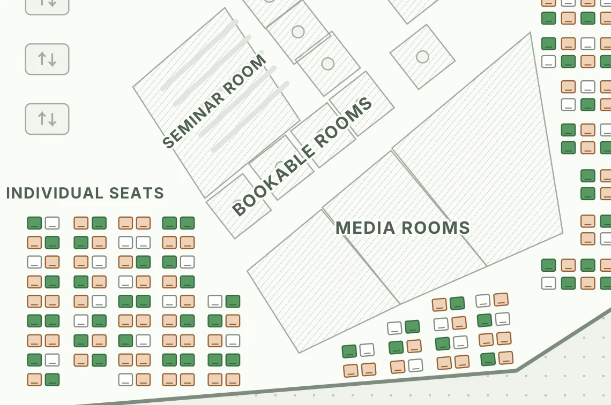
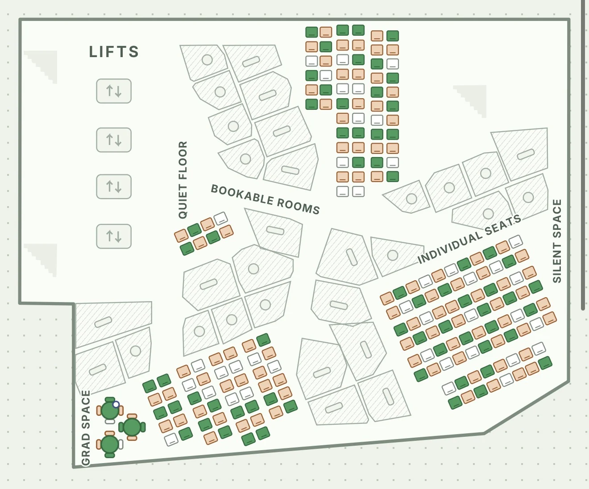
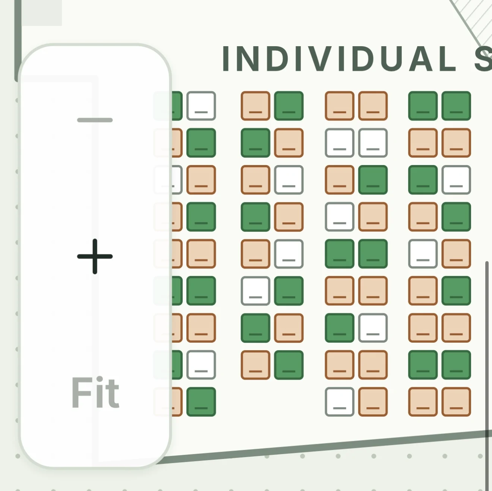
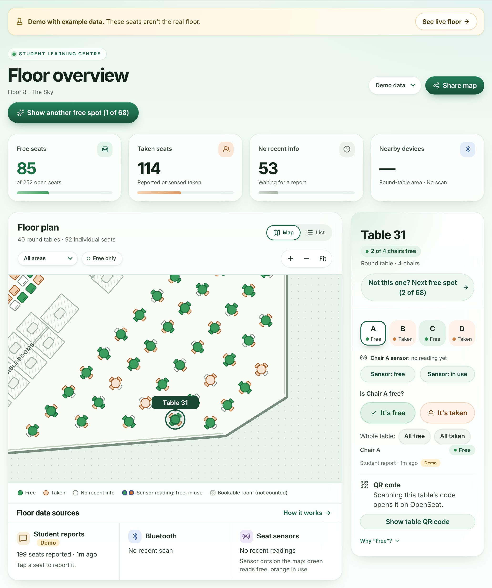
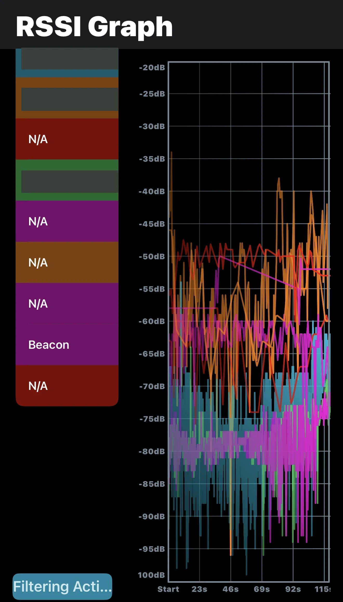
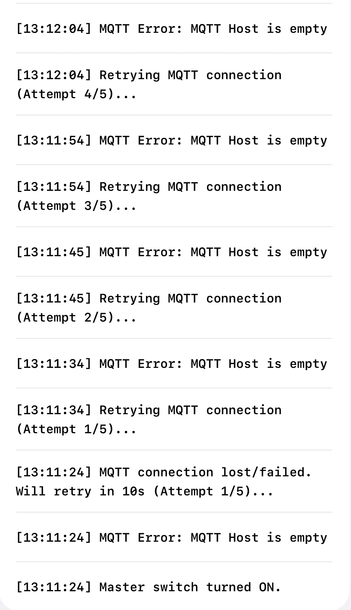
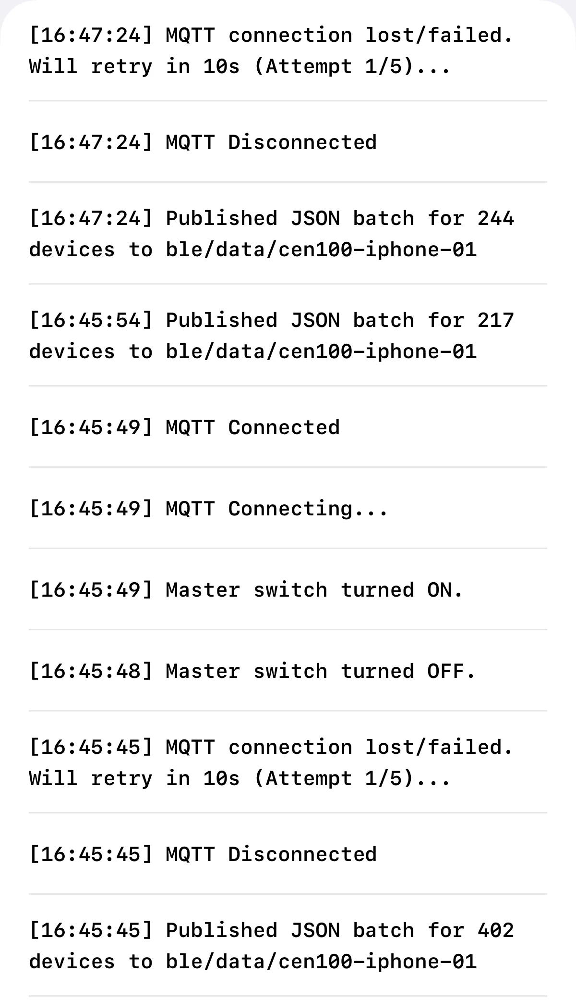
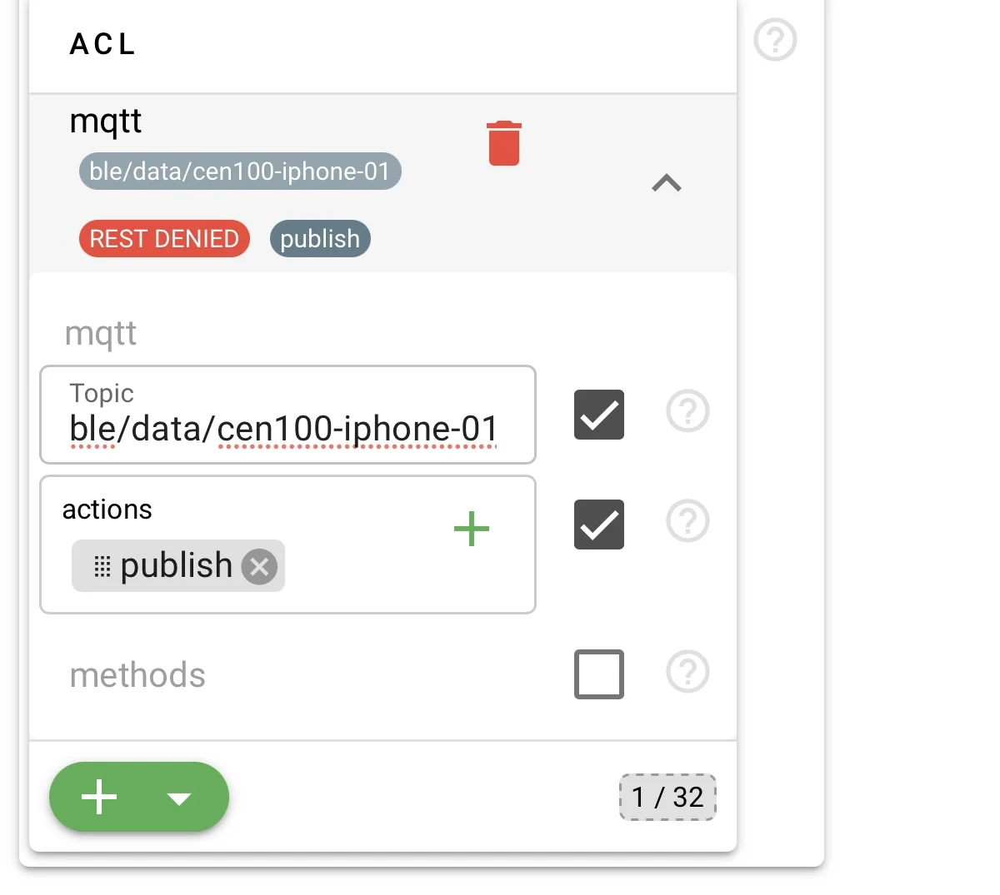
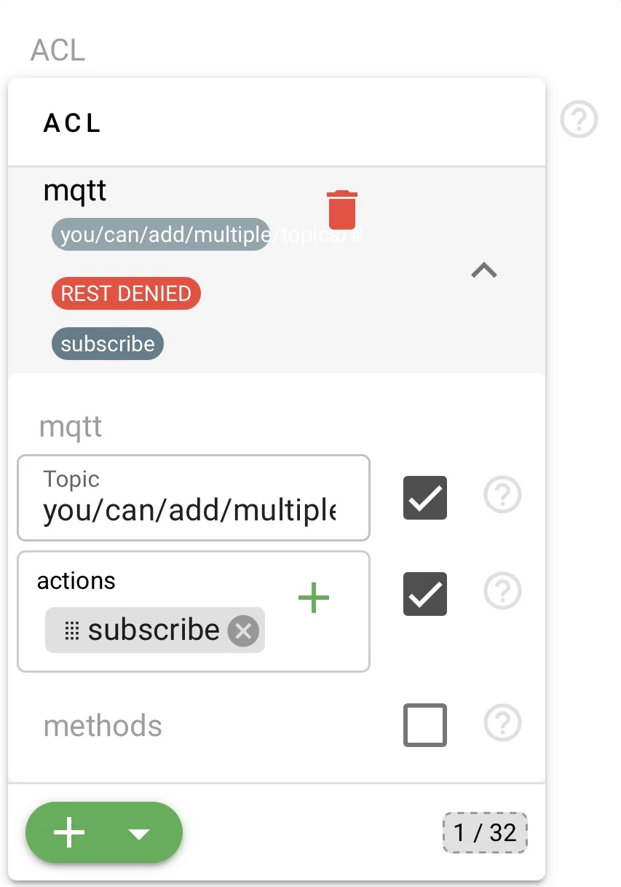
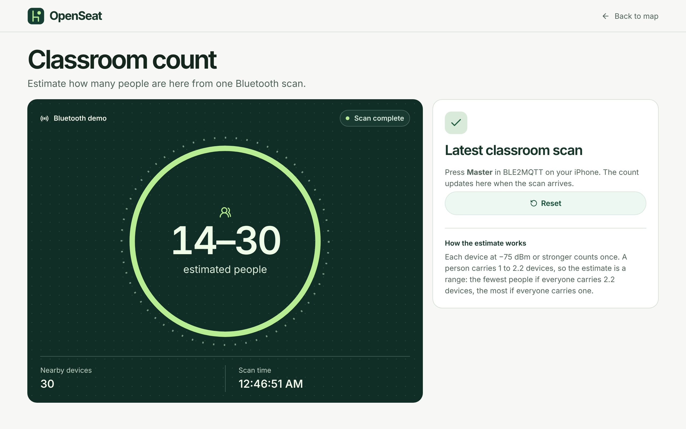

# OpenSeat · CEN100 prototype record

Milestone 5 · Section 29, Group 9 · November 25, 2026

OpenSeat maps **626 open-study seats** in TMU’s Student Learning Centre (SLC). In the demo, a student can open a reported free seat in under 10 seconds. The [total extra cost was **$0**](#materials-and-cost).

## Concept and scope

We wanted students to know where to study before walking there. Our first idea relied on student reports. Once someone found a seat, they had little reason to keep updating the map. That led us to try Bluetooth counting and to design sensors for individual chairs.

Students can report a seat directly or scan its QR code to open it. Each seat shows the source and age of its status. A fresh seat-sensor reading takes priority over a student report. On the live map, a seat returns to **No recent info** once its readings expire. Bluetooth supplies an area count. The classroom demo used an iPhone and an iPad, with simulated seat sensors.

## Map revisions and prototype screenshots

We built Floor 8 first, connected the reports, QR check-ins and simulated readings, then traced Floors 5 and 7 from their own SLC booking maps. The prototype screenshots below were captured on November 22. Select any image to open it at full size.

### Stage 1 · Checking Floor 8 against the drawing

The first trace had 90 individual seats. Checking the drawing again revealed two more. The corrected map has 92 individual seats and 40 four-chair tables, for **252 seats**. The 20 bookable rooms are shown separately.

<figure>
  
  <figcaption><strong>Floor 8 before reports.</strong> All 252 seats start with no recent information.</figcaption>
</figure>

### Stage 2 · Correcting the Floor 5 and Floor 7 layouts

Each pair shows an earlier trace and the corrected layout for the same floor. The seat totals exclude bookable rooms.

#### Floor 5

  <figure>
    
    <figcaption><strong>Earlier layout.</strong> Detail from the first trace, showing the individual seats beside the seminar and media rooms.</figcaption>
  </figure>
  <figure>
    
    <figcaption><strong>Corrected layout · 166 seats.</strong> All are individual seats. The count excludes 11 bookable rooms, a seminar room and three media rooms.</figcaption>
  </figure>

#### Floor 7

  <figure>
    
    <figcaption><strong>Earlier layout.</strong> The first trace of the Floor 7 seating blocks.</figcaption>
  </figure>
  <figure>
    
    <figcaption><strong>Corrected layout · 208 seats.</strong> There are 196 individual seats and three four-chair tables in the graduate space. The count excludes 30 bookable rooms.</figcaption>
  </figure>

### Stage 3 · Showing which chair is free

A table can have both free and occupied chairs. We changed the prototype from one sensor per table to one simulated sensor per chair. We also moved the desktop zoom controls clear of the seats they used to cover.

  <figure>
    
    <figcaption><strong>Earlier controls.</strong> Zoom and Fit covered seats along the left edge of the map.</figcaption>
  </figure>
  <figure>
    
    <figcaption><strong>Seat-level result.</strong> Find me a free seat opened Table 31 with two of its four chairs free. Chair A’s panel shows the source, age, simulated sensor controls and student report buttons.</figcaption>
  </figure>

### Stage 4 · Opening a seat from its QR code

The first version used a QR check-in. We simplified each code to a direct link. A student scans the code to open that table or seat, then chooses whether to report it free or taken.

<figure>
  
  <figcaption><strong>Table 17, Floor 8.</strong> The same destination can be opened by scanning the code or following the link.</figcaption>
</figure>

## Bluetooth calibration

A scan in a room with about **20 people** detected **over 150 devices**. To see how signal strength varied, we recorded five readings from the same device in the library. We set an inclusive **−75 dBm** cutoff. Two of the five readings met it. Each device counts once per scan.

| Reading (same device) | Signal strength | Counted at −75 dBm |
| --- | ---: | --- |
| First | −80 dBm | No |
| Second | −82 dBm | No |
| Third | −80 dBm | No |
| Fourth | −73 dBm | Yes |
| Fifth | −72 dBm | Yes |

<figure class="signal-figure">
  
  <figcaption><strong>Bluetooth signal during the scan.</strong> The traces fluctuate. The cutoff filters device readings for an area estimate. It cannot locate an empty chair.</figcaption>
</figure>

## Connecting the scanner

BLE2MQTT sent scan batches from the iPhone to the flespi MQTT broker. The scanner had permission to publish, and a separate subscriber could read the messages. A ChatGPT Sites relay passed the count to the classroom page.

  <figure>
    
    <figcaption><strong>Before setup.</strong> The scanner kept retrying because the MQTT host field was empty.</figcaption>
  </figure>
  <figure>
    
    <figcaption><strong>After setup.</strong> Published batches included 217, 244 and 402 device records. The connection subsequently dropped. These are raw batch sizes.</figcaption>
  </figure>

### Scanner and relay permissions

  <figure>
    
    <figcaption><strong>Scanner.</strong> Publish permission on the scanner topic.</figcaption>
  </figure>
  <figure>
    
    <figcaption><strong>Subscriber.</strong> The subscribe action selected during setup.</figcaption>
  </figure>

### Stage 5 · Reading the classroom estimate

The classroom page uses an assumption of **1 to 2.2 devices per person**. The screenshot uses a **test input of 30 devices**, which displays a range of **14 to 30 people**. The published batches above came from the phone scanner.

<figure>
  
  <figcaption><strong>Classroom demo.</strong> The estimate applies to the area. Individual seats keep their own status.</figcaption>
</figure>

## Verification

The early QR check-in appeared in a second browser in **1.38 s and 1.46 s** across two checks. The current design shares seat reports through Firebase and keeps the same **10-second** target. [Release checks and test logs](https://github.com/jude27mad/OpenSeat/actions/workflows/pages.yml)

| Test | Result | Evidence |
| --- | --- | --- |
| Count open-study seats across all three floors | Pass | [Inventory tests](https://github.com/jude27mad/OpenSeat/blob/main/tests/floor.test.js) check 252 + 208 + 166 = 626 and exclude the rooms. |
| Apply the inclusive −75 dBm cutoff and count each device once | Pass | [Bluetooth filtering test](https://github.com/jude27mad/OpenSeat/blob/main/tests/floor.test.js) checks readings on both sides of the cutoff and repeated identifiers. |
| Save reports, sensor readings and Bluetooth counts to the shared database | Pass | [Firebase rules tests](https://github.com/jude27mad/OpenSeat/blob/main/tests/firebase/rules.test.js) exercise the accepted data and write permissions. |
| Show a report on a second screen within 10 seconds | Pass | The [two-browser test](https://github.com/jude27mad/OpenSeat/blob/main/tests/browser/prototype.spec.js) times a report from one device appearing on the other. |
| Open a specific table or seat from its QR code | Pass | The [browser test](https://github.com/jude27mad/OpenSeat/blob/main/tests/browser/prototype.spec.js) decodes a table QR code and follows its link. The [link tests](https://github.com/jude27mad/OpenSeat/blob/main/tests/floor.test.js) check chair and individual-seat destinations. |
| Keep individual seats unknown after an area count | Pass | In the [128-device test](https://github.com/jude27mad/OpenSeat/blob/main/tests/floor.test.js), the area count updated and every seat stayed unknown. |
| Give a fresh seat sensor priority and expire old live readings | Pass | [Simulated readings](https://github.com/jude27mad/OpenSeat/blob/main/tests/floor.test.js) check priority and expiry. Physical sensors have yet to be installed. |
| Find a reported free seat in the demo within 10 seconds | Pass | The [desktop and phone tests](https://github.com/jude27mad/OpenSeat/blob/main/tests/browser/find-seat.spec.js) open the demo and select **Find me a free seat**. |
| Connect the scanner and publish batches continuously | Partial | The [scanner logs](#connecting-the-scanner) show successful publishes and intermittent disconnections. |
| Identify physically free seats at peak hours | Not tested | No simultaneous on-site chair counts were collected to compare with the map. Real sensor accuracy and campus-wide coverage are unmeasured. |
| Reduce the time students spend finding a physical seat | Not tested | No on-site trial timed students finding a seat with and without OpenSeat. |

## Build plan and materials

| Step | Goal and materials | Date and evidence |
| --- | --- | --- |
| 1. Establish scope | Count open seating and draw excluded rooms separately. Floor 8 has 252 seats, Floor 7 has 208 and Floor 5 has 166. | Nov 17–19 · [Floor maps](#process-evidence) |
| 2. Set the Bluetooth rule | Use the five reference readings to set the inclusive −75 dBm cutoff. Count each device once per scan. | Nov 17 · [Calibration](#calibration-already-completed) |
| 3. Build the Floor 8 map | Trace the supplied drawing, number every table and seat, and make them searchable. Add the two individual seats found during the recount. | Nov 17–18 · Stage 1 |
| 4. Connect the inputs and test | Connect student reports, QR check-ins, the table-sensor receiver and Bluetooth counts across browsers. Write the first automated tests. Move shared data from Floot to Firebase and add a daily job to delete unused demo rooms. | Nov 17–18 · Firebase switch on Nov 18 |
| 5. Add Floors 5 and 7 | Trace both floors from the library’s booking maps in the same style as Floor 8. | Nov 19 · Stage 2 |
| 6. Switch to seat sensors | Give each seat its own sensor status. Demo buttons simulate seat-sensor readings. The floor scanner uses real Bluetooth input. | Nov 20–21 · Stage 3 |
| 7. Add the classroom count | Convert one Bluetooth scan into a range of people for the classroom demo. | Nov 21 · Stage 5 |
| 8. Simplify QR codes | Replace QR check-ins with direct links to the selected table or seat. | Nov 22 · Stage 4 |

<h3 id="materials-and-cost">Materials and cost</h3>

| Item | What it was used for | Extra cost |
| --- | --- | --- |
| iPhone, nRF Connect and BLE2MQTT | Measure signal strength, publish Bluetooth scans and test the website on a phone | $0 · existing phone |
| iPad | Test the map and shared updates on a second screen | $0 · existing tablet |
| SLC floor drawings | Trace Floor 8 from the supplied plan and Floors 5 and 7 from the library’s booking maps | $0 |
| flespi and ChatGPT Sites relay | Receive the phone’s scan messages and forward the count to the classroom page | $0 |
| Firebase Realtime Database | Share reports, sensor readings and Bluetooth counts across devices on the free plan | $0 |
| GitHub Pages | Host the website | $0 |
| Seat sensors | Simulate readings with demo buttons. No hardware was purchased or installed. | $0 |
| **Total extra cost** | **No purchases for this build** | **$0** |

## Attribution

**Jude Ahmad** worked on the Bluetooth experiments and cutoff, floor selection, furniture inventory and mapping, the dashboard reference, design decisions, website direction and testing.

**AI-assisted development** helped implement the React prototype, shared data service, QR codes, sensor simulator and tests. AI tools also helped prepare the screenshots and documentation.

The team notebook is the source for the remaining group members’ contributions. Those entries were pending when the November 25 record was prepared.
