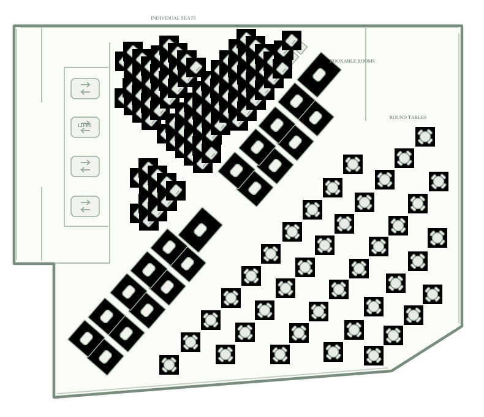

# OpenSeat · CEN100 prototype record

Milestone 5 prototype: how it was built and tested.

## Concept and scope

Find a free study seat before walking over. One map, four inputs: student reports, QR check-in, Bluetooth counts and table sensors. Each reading shows its source and age. Scope: SLC Floor 8, demoed on an iPhone and iPad.

## Build plan and materials

| Step | Goal and materials | Date and evidence |
| --- | --- | --- |
| 1. Establish scope | Trace the supplied floor drawing with 40 four-chair tables, 92 individual seats and 20 separate bookable rooms. | Nov 17 · traced layout below |
| 2. Establish Bluetooth rule | Use the existing BLE2MQTT calibration readings to set an inclusive −75 dBm cutoff for counting devices. | Nov 17 · recorded calibration below |
| 3. Build the map | Trace furniture positions, assign prototype IDs, add searchable seats, then attach observation scope, timestamps, conflict rules and expiry. | Nov 17 · dashboard image below |
| 4. Wire the four inputs | Connect shared storage, explicit QR check-in/out, one-tap free/occupied reports, a sensor receiver and local BLE scan reduction. | Nov 17 · table QR screen below |
| 5. Verify the student journey | Exercise the UI, shared service, QR code and state rules. Keep measured results separate from human or physical trials. | Nov 17 · verification table below |

The planned phone, iPad, floor drawing and BLE2MQTT scans were already available. The estimated and actual additional hardware cost was $0. A simulated input replaced physical table hardware for this build. GitHub Pages serves the dashboard and a managed database service shares observations across browsers.

## Process evidence

**Stage 1.** Floor plan: 252 open seats, all unknown.

**Stage 2.** Full demo with all four inputs. Example readings are marked simulated.

**Stage 3.** Each table's QR code opens check-in for that table.

## Calibration already completed

| Reading (same device) | Power | Counted at −75 dBm |
| --- | ---: | --- |
| First | −80 dBm | No |
| Second | −82 dBm | No |
| Third | −80 dBm | No |
| Fourth | −73 dBm | Yes |
| Fifth | −72 dBm | Yes |

Taken in the library. It sets the threshold but doesn't measure people on Floor 8.

## Verification

Every release is tested automatically in desktop and phone browsers. [Release checks](https://github.com/jude27mad/OpenSeat/actions/workflows/pages.yml)

| Test | Result | Evidence |
| --- | --- | --- |
| 252 seats counted, 20 rooms excluded | Pass | Automated check |
| −75 dBm cutoff, each device counted once | Pass | Automated tests |
| All four inputs saved together | Pass | API and database rule tests |
| Check-in shows on a second screen within 10 s | Pass | 1.38 s in an earlier build |
| A phone can scan a table QR and use the map | Pass | 1.46 s phone to desktop · [test run](https://github.com/jude27mad/OpenSeat/actions/runs/44208568779) |
| Area counts don't fake seat counts | Pass | 128 devices left all seats unknown |
| Sensor conflicts and old readings handled | Pass | Automated tests |
| A student finds a seat within 10 s | Not measured | Needs a timed trial |
| Real sensors and campus-wide accuracy | Not measured | No installed hardware |

## Attribution

**Student design work** included the integration concept, the choice of Floor 8 and dashboard reference, the furniture inventory and map, and the Bluetooth calibration and cutoff.

**AI-assisted development** implemented the React prototype, shared service, QR codes, simulator and tests from those design decisions, and produced this build record and screenshots.
